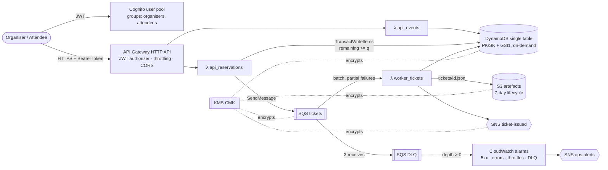

# TixLane

[](https://github.com/teodor004/serverless-aws-tixlane/actions/workflows/ci.yml)
[](https://github.com/teodor004/serverless-aws-tixlane/actions/workflows/deploy.yml)


An event-ticketing service built as an **AWS serverless reference architecture**: it runs fully
on a local emulator, passes its quality gates in CI, deploys to a real AWS account for 48 hours
through an approval-gated OIDC pipeline, and is then torn down with a documented, verified
teardown.

> **New here?** Start with **[docs/GETTING_STARTED.md](docs/GETTING_STARTED.md)**. It covers what
> TixLane does in plain words, a glossary, what you can try without an AWS account, and
> copy-paste commands with expected output, example API calls and troubleshooting.

> **Status (2026-10-13): locally reviewed, not yet run against an emulator or AWS.** All
> phases' artefacts are written. A local review (no AWS access) ran the unit suite (99 passed,
> 99.6% coverage), ruff, mypy --strict, `tofu fmt`/`validate` on all roots, tflint, Trivy,
> Checkov, actionlint, gitleaks and `k6 inspect`, and pinned every tool and action. The
> emulator steps (P2/P3) are pending: Docker was unavailable on the review machine. Still
> open in `docs/VERIFICATION_LOG.md`: emulator behaviour and AWS terms.

## What it does

| Who | Endpoint | Behaviour |
|---|---|---|
| Organiser | `POST /events` | Create an event with a fixed capacity |
| Organiser / attendee | `GET /events/{id}` | Read an event, including seats remaining |
| Attendee | `POST /events/{id}/reservations` + `Idempotency-Key` | Write a **PENDING** reservation with a conditional capacity decrement (no overselling), enqueue it, answer `202` |
| Owner / event organiser | `GET /reservations/{id}` | Read status: `PENDING` → `CONFIRMED` |

The worker Lambda confirms the reservation, writes `tickets/{id}.json` to S3 and publishes to
SNS `ticket-issued`. A poison message moves to the DLQ after 3 receives, and the DLQ-depth alarm
notifies `ops-alerts`.

## Architecture



Full C4 context/container and sequence diagrams: [`docs/ARCHITECTURE.md`](docs/ARCHITECTURE.md).

## Local quickstart (emulator only)

Prerequisites: Windows 11 + WSL2 Ubuntu, Docker Engine inside WSL2, the repository on the WSL
filesystem, and `uv`, `tofu`, `k6`, `jq`, `curl` installed.

```bash
cp .env.example .env          # set FLOCI_IMAGE (and MINISTACK_IMAGE) after verifying them (V-001, V-003)
uv lock && make install       # first run only; creates uv.lock
make test                     # unit tests (Moto), 90% coverage gate

make up && make local-apply && make itest
```

`make local-apply` builds the Lambda zip, applies `infra/envs/local` to the emulator, then runs a
second `tofu plan` that must show no changes. Other targets: `make k6-smoke`, `make dlq-drill`,
`make up EMULATOR=ministack` (cross-check), `make local-destroy`, `make down`, `make help`.
Known or suspected emulator gaps and their flags: [`docs/EMULATOR_GAPS.md`](docs/EMULATOR_GAPS.md).
A step-by-step walk-through with expected output, example `curl` calls and fixes for common
errors is in [`docs/GETTING_STARTED.md`](docs/GETTING_STARTED.md#6-level-2-run-the-whole-system-on-your-machine-emulator).

## Real-deploy story (P6–P7)

1. **Architect, by hand:** root MFA, admin user, $1 budget (50/80/100% + forecast alerts),
   Free Tier alerts, Cost Explorer. Then `tofu -chdir=bootstrap apply` (state bucket, state
   CMK, GitHub OIDC provider, deploy role + workload permissions boundary).
2. Copy the bootstrap outputs into **GitHub → Environments → production → Variables**
   (`TF_STATE_BUCKET`, `TF_STATE_KMS_KEY_ARN`, `AWS_DEPLOY_ROLE_ARN`, `WORKLOAD_BOUNDARY_ARN`)
   plus `AWS_ACCOUNT_ID`, `OWNER`, `CORS_ALLOWED_ORIGINS`, optional `ALERT_EMAIL`. Add yourself as
   required reviewer. (CI itself needs only the repository variables `FLOCI_IMAGE` and
   `MINISTACK_IMAGE`, plus the optional secret `INFRACOST_API_KEY`.)
3. Run **deploy.yml** (workflow_dispatch). Approve once to plan, read the plan in the job
   summary, approve again to apply *that saved plan*. Smoke + k6 run against AWS, and evidence is
   uploaded as an artifact.
4. Within 48 h, **ops.yml** runs a bounded k6 spike (≤ 50 VUs, ≤ 5 min), the DLQ alarm drill and
   evidence snapshots. Screenshots are captured manually ([`docs/evidence/`](docs/evidence/README.md)).
5. **destroy.yml** (typed confirmation + approvals), then the tag sweep, which must return 0.
   The architect tears down bootstrap and deletes the state bucket last
   ([`docs/TEARDOWN.md`](docs/TEARDOWN.md)).

Real AWS is reached **only** through those workflows, via OIDC (no long-lived keys), with the
trust policy pinned to `repo:teodor004/serverless-aws-tixlane:environment:production`.

## Cost

Target: **net $0.00**. The design stays inside the free tiers (on-demand DynamoDB, 7-day logs and
lifecycle, 8 alarms, one dashboard, no NAT/VPC/RDS/WAF/provisioned concurrency). The only
fixed-price items are the KMS keys (~$1/month each, prorated), covered by Free-plan credits.
Estimate, Infracost method, the estimate-vs-actual table and risks (including RISK-01, the
new-account Lambda concurrency quota): [`docs/COST.md`](docs/COST.md).

## Security

Cognito JWT on every route, with group rules enforced in code. There is one least-privilege role per
function, with no wildcard actions. Everything is encrypted with a CMK, every resource policy is
TLS-only, and S3 has public access blocked. The deploy role can only create roles that carry the
workload permissions boundary. Actions are SHA-pinned, tool versions are verified before use,
gitleaks runs with a custom account-ID rule, and Claude Code guardrails (deny rules plus a
PreToolUse hook) block real-AWS mutations and secret commits.
See [`docs/SECURITY.md`](docs/SECURITY.md) and the STRIDE model in
[`docs/THREAT_MODEL.md`](docs/THREAT_MODEL.md). Well-Architected mapping:
[`docs/WELL_ARCHITECTED.md`](docs/WELL_ARCHITECTED.md).

## Architecture decisions

| ADR | Decision |
|---|---|
| [0001](docs/adr/0001-emulator-strategy.md) | Floci primary, MiniStack cross-check, LocalStack optional; feature-flagged gaps |
| [0002](docs/adr/0002-single-table-dynamodb.md) | Single-table DynamoDB with GSI1 |
| [0003](docs/adr/0003-conditional-capacity-write.md) | Conditional capacity write in one transaction |
| [0004](docs/adr/0004-idempotency-in-transaction.md) | Idempotency record inside the same transaction |
| [0005](docs/adr/0005-kms-customer-managed-key.md) | Customer-managed KMS key vs AWS-owned keys |
| [0006](docs/adr/0006-async-confirmation-sqs-dlq.md) | Async confirmation via SQS, DLQ after 3 receives |
| [0007](docs/adr/0007-cicd-oidc-approval-gated-deploys.md) | OIDC, approval-gated plan → apply of the saved plan |
| [0008](docs/adr/0008-scanner-suppressions.md) | Scanner suppression policy and register |

## Evidence

| Item | Location |
|---|---|
| Smoke + k6 results, deploy timestamps | [`docs/evidence/`](docs/evidence/README.md) *(pending P6)* |
| Spike, DLQ drill, snapshots, screenshots | [`docs/evidence/`](docs/evidence/README.md) *(pending P7)* |
| Tag sweep = 0, teardown timestamps | [`docs/TEARDOWN.md`](docs/TEARDOWN.md) *(pending P7)* |
| Estimate vs actual spend | [`docs/COST.md`](docs/COST.md) *(pending P7)* |
| Verification checks | [`docs/VERIFICATION_LOG.md`](docs/VERIFICATION_LOG.md) *(pending P0)* |

## Phases

| Phase | Scope | State |
|---|---|---|
| P0 | Verify versions/flags/emulators (≥30 checks), scaffold, pre-commit, CLAUDE.md | 60 checks logged; 22 settled locally; emulator/AWS rows pending |
| P1 | Domain, handlers, idempotency, conditional write; Moto tests ≥90% incl. 50→10 concurrency | **Passing locally**: 99 tests, 99.6% coverage; mutation check proves the 50→10 test |
| P2 | IaC + apply on Floci, empty second plan, gaps documented | `tofu validate` clean on all roots; **apply pending (needs Docker + emulator images)** |
| P3 | Integration: Cognito → API → confirm ≤30 s → S3; poison → DLQ → alarm; MiniStack ADR | 5 tests collect; **not run (needs emulator)** |
| P4 | CI gates green, justified suppressions, Infracost in COST.md | Every gate green **locally**; suppressions proven (ADR-0008); CI run and Infracost (API key) pending |
| P5 | Architecture, 8 ADRs, Well-Architected, threat model, security, cost, teardown | Written |
| P6 | Real deploy via OIDC + approval, smoke + k6 evidence | Workflow ready; **architect's day-1 setup first** |
| P7 | Spike, screenshots, destroy, tag sweep 0, teardown + cost actuals | Workflows/runbook ready |

## Repository layout

```
src/tixlane/            domain, repository, services, handlers (3 Lambdas, one package)
tests/unit|integration  Moto unit tests | emulator-only integration tests
k6/                     smoke.js, spike.js (bounded)
infra/modules/          api auth compute data messaging storage observability iam_oidc
infra/envs/local|aws    emulator root (local state) | AWS root (S3 backend, lockfile, encryption)
bootstrap/              state bucket + CMK, GitHub OIDC provider, deploy role (manual apply)
scripts/                build_lambda.py, e2e.py, tag_sweep.sh, wait/check helpers
.github/workflows/      ci.yml, deploy.yml, destroy.yml, ops.yml
.claude/                settings.json (deny/ask rules) + hooks/guard.py (PreToolUse)
docs/                   architecture, ADRs, verification log, gaps, threat model, cost, teardown, evidence
```

See [`NOTICE.md`](NOTICE.md) for the clean-room statement and the public sources consulted.
