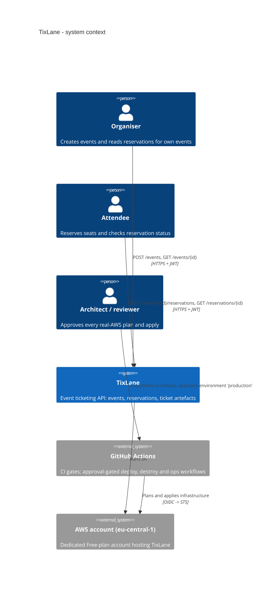
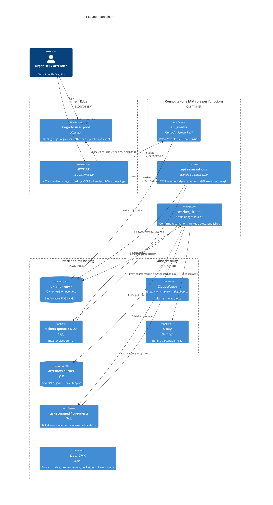
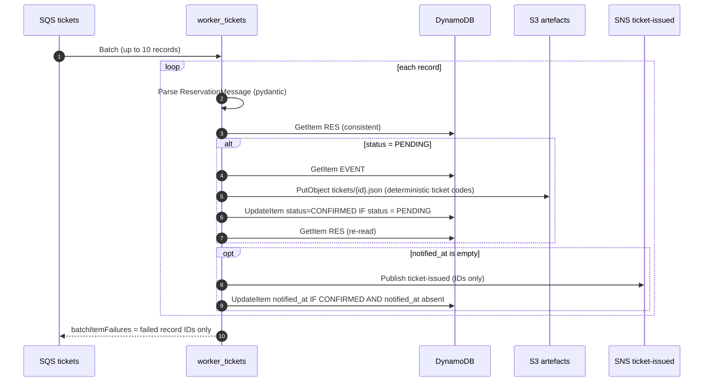
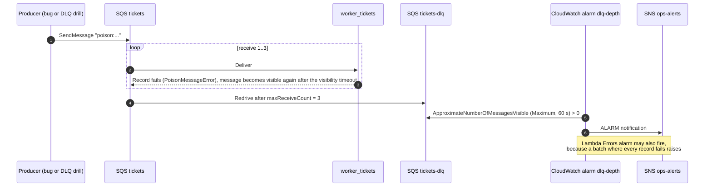

# TixLane architecture

> Status: designed and implemented as code, **not yet executed**. Every behavioural claim
> below is an expectation, to be confirmed in the phase noted (P1 unit tests, P2 emulator
> apply, P3 integration tests, P6/P7 real AWS). Unverified platform facts are tracked as
> V-items in [VERIFICATION_LOG.md](VERIFICATION_LOG.md); emulator differences as G-items in
> [EMULATOR_GAPS.md](EMULATOR_GAPS.md).

## 1. Overview

TixLane is a small event-ticketing service built as an AWS serverless reference architecture:

- **Organisers** create events with a fixed capacity and read them back.
- **Attendees** reserve seats. A reservation is accepted synchronously as `PENDING` and confirmed
  asynchronously by a worker, which writes a ticket artefact to S3 and announces it on SNS.
- **Overselling is impossible by construction**: the capacity decrement, the reservation write
  and the idempotency claim are a single conditional DynamoDB transaction
  ([ADR-0003](adr/0003-conditional-capacity-write.md), [ADR-0004](adr/0004-idempotency-in-transaction.md)).
- **Poison messages** leave the main queue after 3 receives, land in a DLQ, and a CloudWatch alarm
  notifies `ops-alerts` ([ADR-0006](adr/0006-async-confirmation-sqs-dlq.md)).

Constraints that shaped the design: $0 budget on a fresh Free-plan account, `eu-central-1` only,
no NAT / VPC Lambdas / public IPv4 / RDS / provisioned concurrency / WAF, on-demand DynamoDB,
7-day log retention and 7-day S3 lifecycle. The full stack also runs on a local emulator
([ADR-0001](adr/0001-emulator-strategy.md)).

## 2. System context (C4 level 1)



## 3. Containers (C4 level 2)



## 4. Key flows

### 4.1 Sign-in and reservation (synchronous part)

```mermaid
sequenceDiagram
  autonumber
  actor A as Attendee
  participant C as Cognito
  participant G as HTTP API (JWT authorizer)
  participant R as api_reservations
  participant D as DynamoDB
  participant Q as SQS tickets

  A->>C: InitiateAuth (SRP, or USER_PASSWORD_AUTH for scripted clients)
  C-->>A: Access token (cognito:groups = attendees)
  A->>G: POST /events/{id}/reservations<br/>Authorization: Bearer, Idempotency-Key, {"quantity": 2}
  G->>G: Verify signature, issuer, audience, expiry
  G->>R: Invoke with verified claims in requestContext
  R->>R: Require group attendees, token_use=access; validate key, path id, body
  R->>D: TransactWriteItems<br/>1. Update EVENT: remaining -= q IF remaining >= q<br/>2. Put RES (PENDING) IF not exists<br/>3. Put IDEMP#sub#key IF not exists
  D-->>R: Committed
  R->>Q: SendMessage {version, reservation_id, event_id}
  R-->>G: 202 Accepted, Location: /reservations/{id}
  G-->>A: 202 + reservation (status PENDING)
```

If the transaction is cancelled, the handler works out the reason with consistent reads
(`src/tixlane/repository.py`, `_resolve_cancellation`). An existing idempotency record means
a replay (4.4). A missing event returns 404. Insufficient `remaining` returns 409. Anything else
is a transient conflict, retried with jittered backoff up to 5 attempts, then 503.

### 4.2 Worker confirmation



The artefact is written before the status flips, so `CONFIRMED` always implies the ticket
exists. Every step is safe to repeat. Only the SNS publish is at-least-once (see §9).

### 4.3 Poison message to alarm



### 4.4 Idempotent replay, including the enqueue-failure heal

```mermaid
sequenceDiagram
  autonumber
  actor A as Attendee
  participant R as api_reservations
  participant D as DynamoDB
  participant Q as SQS tickets

  A->>R: POST reservation, Idempotency-Key K
  R->>D: TransactWriteItems (commits; seat held, IDEMP#sub#K written)
  R->>Q: SendMessage
  Q--xR: Error
  R-->>A: 503 enqueue_failed, Retry-After: 1
  A->>R: Same POST, same key K
  R->>D: TransactWriteItems
  D-->>R: Cancelled (IDEMP#sub#K exists)
  R->>D: GetItem IDEMP#sub#K (consistent): request_hash matches
  R->>D: GetItem RES (still PENDING)
  R->>Q: SendMessage again (the worker is idempotent)
  R-->>A: 202, same reservation, Idempotent-Replayed: true
  Note over A,R: Same key with a different body (other event or quantity)<br/>returns 422 idempotency_key_reused
```

### 4.5 Real deployment (to be confirmed in P6)

```mermaid
sequenceDiagram
  autonumber
  actor Ar as Architect
  participant GH as GitHub Actions (deploy.yml)
  participant STS as AWS STS
  participant S3 as State bucket (S3, lockfile)
  participant AWS as TixLane resources

  Ar->>GH: workflow_dispatch
  GH->>Ar: Approval request (environment production)
  Ar-->>GH: Approve (1/2)
  GH->>STS: AssumeRoleWithWebIdentity<br/>sub = repo:teodor004/serverless-aws-tixlane:environment:production
  STS-->>GH: Short-lived deploy-role credentials
  GH->>GH: Build deterministic lambda.zip
  GH->>S3: tofu init / plan -out (state and plan encrypted with the state CMK)
  GH->>GH: Upload encrypted plan + zip as a short-lived artifact; plan summary to job summary
  GH->>Ar: Approval request for apply
  Ar-->>GH: Approve (2/2) after reading the plan
  GH->>AWS: tofu apply <saved plan>
  GH->>AWS: scripts/e2e.py smoke --allow-real-aws, then the k6 smoke
  GH->>GH: Delete ephemeral users; upload evidence artifact
  Ar->>Ar: Curate evidence into docs/evidence/
```

`destroy.yml` follows the same plan → approve → apply-saved-plan shape (`plan -destroy`) and
ends with the read-only tag sweep `scripts/tag_sweep.sh`
([ADR-0007](adr/0007-cicd-oidc-approval-gated-deploys.md), [TEARDOWN.md](TEARDOWN.md)).

## 5. API contract

Every route requires a Cognito **access token**. Groups come from the `cognito:groups` claim
and are enforced in the handlers (`src/tixlane/auth.py`). Error bodies use the shape
`{"error": {"code", "message", "details"?}}`.

| Method | Path | Group(s) | Success | Errors |
|---|---|---|---|---|
| POST | `/events` | organisers | **201**, `Location: /events/{id}` | 400 validation · 401 · 403 not an organiser |
| GET | `/events/{id}` | organisers, attendees | **200** | 401 · 403 · 404 unknown or malformed id |
| POST | `/events/{id}/reservations` | attendees | **202**, `Location: /reservations/{id}`; replay adds `Idempotent-Replayed: true` | 400 missing/invalid `Idempotency-Key` or body · 401 · 403 · 404 event · **409** `sold_out` · **422** `idempotency_key_reused` · **503** `service_busy` / `enqueue_failed` + `Retry-After: 1` |
| GET | `/reservations/{id}` | attendees (own), organisers (own events) | **200** | 401 · 403 · 404 (also returned for "not yours", so IDs cannot be probed) |

Request rules: `Idempotency-Key` is 8 to 128 characters of `[A-Za-z0-9_-]` and is scoped per
caller. `quantity` is 1 to 10 (default 1). `capacity` is 1 to 10,000. `starts_at` must be
timezone-aware and in the future. Unknown fields are rejected (`extra="forbid"`,
`src/tixlane/models.py`). The API stage throttles at 10 rps with a burst of 20 and returns
429 above that.

## 6. Data model

Single table `tixlane-<env>`, keys `PK`/`SK` (strings), plus GSI1 (`GSI1PK`/`GSI1SK`,
projection ALL), TTL on `expires_at` ([ADR-0002](adr/0002-single-table-dynamodb.md),
`infra/modules/data/main.tf`, `src/tixlane/keys.py`).

| Entity | PK | SK | GSI1PK / GSI1SK | Notable attributes |
|---|---|---|---|---|
| Event | `EVENT#<event_id>` | `META` | — | `capacity`, `remaining`, `organiser_id`, `starts_at` |
| Reservation | `RES#<reservation_id>` | `META` | `EVENT#<event_id>` / `RES#<created_at>#<reservation_id>` | `attendee_id`, `quantity`, `status` (PENDING/CONFIRMED), `ticket_key`, `confirmed_at`, `notified_at` |
| Idempotency | `IDEMP#<sub>#<key>` | `META` | — | `reservation_id`, `request_hash` (SHA-256 of event id + body), `expires_at` (TTL, 24 h) |

The S3 artefact `tickets/<reservation_id>.json` (model `Ticket`) holds the event name, venue,
start time, attendee id, quantity and one UUIDv5 code per seat. Codes are derived from the
reservation id, so a redelivery rewrites identical content.

## 7. IaC layout

```
infra/
  modules/
    data/           KMS CMK + alias, DynamoDB table (PITR flag, TTL, SSE-KMS)
    storage/        artefacts bucket: BPA, BucketOwnerEnforced, SSE-KMS + bucket key, versioning,
                    7-day lifecycle, TLS-only (and TLS >= 1.2) policy
    messaging/      tickets queue + DLQ (redrive 3, redrive-allow), TLS-only queue policies,
                    SNS ticket-issued + ops-alerts (CloudWatch publish), optional e-mail subscription
    auth/           Cognito user pool (admin-create-only, MFA optional), groups, public client
    compute/        3 functions, 3 roles, 3 log groups (7 d, CMK), SQS event source mapping
    api/            HTTP API, JWT authorizer, 4 routes, $default stage (throttling, access logs)
    observability/  8 alarms -> ops-alerts, dashboard
    iam_oidc/       GitHub OIDC provider, deploy role (4 managed policies), workload boundary
  envs/
    local/          emulator endpoints and dummy credentials, local state, emulator flags
    aws/            S3 backend (use_lockfile), state/plan encryption (encryption.tofu), prod values
bootstrap/          state bucket + state CMK + iam_oidc; applied once by a human
```

Provider `default_tags` on every root: `Project=tixlane`, `Env`, `Owner`, `CostCenter=portfolio`,
`TTL=48h`, `ManagedBy=opentofu`.

## 8. Configuration flags

| Variable (root) | local | aws | Purpose |
|---|---|---|---|
| `python_runtime` | `python3.13` (`python3.12` fallback) | `python3.13` | Runtime fallback for G-10 |
| `auth_mode` | `apigw` (switch to `emulator-unverified` only if G-01 is confirmed) | `apigw`, hard-coded | Where claims come from. Unverified mode is refused by code unless `TIXLANE_ENV=local` and an emulator endpoint is set, and refused by tofu validation unless `env = "local"` |
| `enable_xray` | `false` | `true` | Active tracing (G-04) |
| `reserved_concurrency` | `5` | `5` (`-1` if RISK-01 applies) | Per-function cap; see [COST.md](COST.md) RISK-01 |
| `worker_max_concurrency` | `null` | `2` | ESM `scaling_config` (G-07) |
| `enable_pitr` (data module) | `false` | `true` | Point-in-time recovery (G-09) |
| `enable_dashboard` | `true` | `true` | Disable if the emulator rejects dashboards (G-15) |
| `cognito_issuer_base_url` | `null` | — | Issuer format override (G-02) |
| `lambda_aws_endpoint_url` | `http://emulator:4566` | — (null) | How functions reach the emulator (G-11) |
| `emulator_endpoint` / `emulator_account_id` | `http://localhost:4566` / `000000000000` | — | Provider endpoints and the emulator-only account guard |
| `permissions_boundary_arn` | — (null) | bootstrap output | Required by the deploy role on real AWS |
| `queue_visibility_timeout_seconds` | `30` | `60` | At least 6 × worker timeout (enforced by a `check` block) |
| `worker_timeout_seconds` | `5` | `10` | Worker Lambda timeout |
| `cors_allowed_origins` | `["http://localhost:3000"]` | GitHub variable | Explicit origins; `*` is rejected by validation |
| `throttling_rate_limit` / `throttling_burst_limit` | `10` / `20` | `10` / `20` | Stage throttling |
| `alert_email` | — | `""` (disabled) | Optional ops-alerts e-mail subscription |

## 9. Observability

- **Logs**: Powertools structured JSON logs with the Lambda context and API correlation id
  injected; HTTP API JSON access logs (request id, route, status, latencies, authorizer error,
  `sub`). All log groups keep 7 days and are encrypted with the CMK.
- **Metrics**: AWS service metrics, plus Powertools EMF metrics in namespace `TixLane`:
  `EventsCreated`, `ReservationsCreated`, `SoldOut`, `TicketsIssued`.
- **Alarms** (`infra/modules/observability/main.tf`): 8 alarms, 9 alarm metrics (inside the free
  tier of 10, to be confirmed in P4/P7). All notify `ops-alerts` on ALARM and on OK.

  | Alarm | Signal |
  |---|---|
  | `<prefix>-api-5xx-rate` | metric math `100 * 5xx / Count` > 5 % over 5 min |
  | `<fn>-errors` × 3 | Lambda `Errors` Sum > 0 per minute |
  | `<fn>-throttles` × 3 | Lambda `Throttles` Sum > 0 per minute |
  | `<prefix>-dlq-depth` | DLQ `ApproximateNumberOfMessagesVisible` Maximum > 0 |

- **Dashboard** `<prefix>`: header text; API Count/4xx/5xx; API latency p50/p95/p99; Lambda
  invocations/errors/throttles; Lambda duration p95; queue depth, age of oldest message and DLQ
  depth; DynamoDB consumed RCU/WCU and `ConditionalCheckFailedRequests`; alarm status.
- **Tracing**: X-Ray behind `var.enable_xray`. HTTP APIs are expected **not** to emit X-Ray
  segments, so traces start at the Lambda function. This is recorded as a V-item to verify in
  [VERIFICATION_LOG.md](VERIFICATION_LOG.md) and confirmed with the X-Ray screenshot in P7.

## 10. Failure modes

| Failure | Behaviour | Signal |
|---|---|---|
| Two transactions contend for the same event item | Cancelled with a conflict, then retried with jittered backoff (5 attempts) | 503 `service_busy` only if every retry fails |
| Not enough seats | Transaction cancelled, nothing written | 409; `SoldOut` metric; `ConditionalCheckFailedRequests` |
| SQS send fails after the commit | Seat held, reservation PENDING; the client's retry with the same key re-enqueues | 503 `enqueue_failed` |
| Worker crashes after the S3 put, before confirm | Redelivery rewrites a byte-identical artefact, then confirms | none (by design) |
| Worker crashes after confirm, before publish | Redelivery sees CONFIRMED and no `notified_at`, so it publishes | none |
| Worker crashes after publish, before `mark_notified` | Duplicate `ticket-issued` (at-least-once); subscribers dedupe on `reservation_id` | none; documented in ADR-0006 |
| Malformed or unknown message | Fails 3 receives, then moves to the DLQ | `dlq-depth` alarm (+ worker `errors`) |
| Reserved concurrency reached | API: invocation throttled (5xx at the gateway, to be confirmed P7); worker: backlog builds | `throttles` alarm; queue age widget |
| API request flood | Stage throttling returns 429 before Lambda is invoked | API 4xx widget |
| Unhandled bug in an API handler | Invocation error (deliberately not swallowed) | `errors` + `api-5xx-rate` alarms |
| CMK disabled or pending deletion | Every encrypted read and write fails | errors / 5xx alarms |
| Emulator feature missing | Documented flag or workaround | [EMULATOR_GAPS.md](EMULATOR_GAPS.md) |
